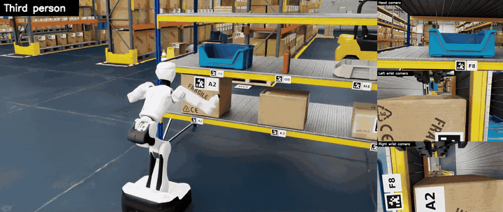

# Factory_Project — Astribot S1 warehouse sorting

An Isaac Lab project in which one Astribot S1 mobile manipulator takes six items off a “To be sorted.” rack,
in alphabetical order of their address, and stacks each one on its pallet in a simulated warehouse. Every item
is a dynamic rigid body; nothing is teleported or attached.

[](recordings/sorting-mission/mission_pov_4x.mp4)

**Full run, 4× speed:** [four camera views](recordings/sorting-mission/mission_pov_4x.mp4) ·
[third-person only](recordings/sorting-mission/mission_4x.mp4)

## Status

| Part | State |
| --- | --- |
| Scripted teacher, standard scene | Works: 6 of 6 items placed in order, no drops |
| Scripted teacher with varied starts | Fragile: about a third of missions complete |
| PPO clamp-and-lift skill | Works in its own environment; not yet wired into the mission |
| Imitation learning (MLP, ACT-style) | Trains, but places nothing in closed loop yet |

No teleoperation data is used. Details, measurements and known limits are in
[docs/sorting-task.md](docs/sorting-task.md).

## Quick start

Run from the repository root with an Isaac Sim 6.2 / Isaac Lab 3.0 Python interpreter.

```bash
PY=~/env_isaaclab/bin/python

$PY scripts/run_mission.py                           # full mission, headless
$PY scripts/run_mission.py --viz kit                 # watch it in the Isaac Sim window
$PY scripts/run_mission.py --record demo --pov       # record the four-view video
$PY scripts/train_skill.py --device cuda --num-envs 256   # train the grasp with PPO
PYTHONPATH=src pytest tests                          # tests that need no simulator
```

A dropped item ends the mission, so the window closes when that happens.

## Repository layout

```text
src/Factory_Project/
  assets/      Robot, warehouse, rack and drop-zone scenes, plus the task manifest
  sorting/     Scripted teacher: stacking rules, route planning, inverse kinematics, skills
  learning/    Demonstration files and the imitation-learning policies
  tasks/       Gym environments: the full mission and the PPO grasp skill
scripts/       Everything you run: build scenes, run the mission, record, train, evaluate
tests/         Simulator-free tests of the rules, planning and learning code
docs/          Design notes and how-to pages
recordings/    Screenshots and videos
outputs/       Demonstrations, checkpoints and reports (git-ignored)
```

| Script | What it does |
| --- | --- |
| `run_mission.py` | Runs the scripted teacher on the mission; can record video |
| `record_demos.py`, `train_bc.py`, `evaluate_policy.py` | Imitation-learning pipeline |
| `train_skill.py` | Trains or plays the PPO clamp-and-lift skill |
| `build_factory.py`, `build_sorting_rack.py`, `build_drop_zones.py`, `build_nav_map.py` | Rebuild the scene and its navigation map |
| `view_scene.py`, `view_factory.py`, `preview.py`, `drive_demo.py` | Look at the robot and the warehouse |

## Documentation

- [The sorting task](docs/sorting-task.md) — scene, putaway rules, how the teacher works, results, limits
- [Factory layout](docs/factory-layout.md) — the warehouse aisles and the sorting rack
- [Policy architecture](docs/policy-arch.md) and [vision](docs/vision.md) — the original design proposal
- [The Astribot S1 asset](docs/robot-asset.md) — loading, driving and validating the robot
- [Authoring and viewing scenes](docs/scene-authoring.md)
- [Installation and development](docs/development.md) — the Isaac Lab template's `uv` workflow and editor setup

## Registered environments

- `FactoryProject-Factory-ASTRIBOTS1-Direct` — the full sorting mission
- `FactoryProject-ClampLift-ASTRIBOTS1-Direct` — the PPO clamp-and-lift skill
- `FactoryProject-Factory-ASTRIBOTS1` and `FactoryProject-Factory-Marl-ASTRIBOTS1-Direct` — unfinished template scaffolding
