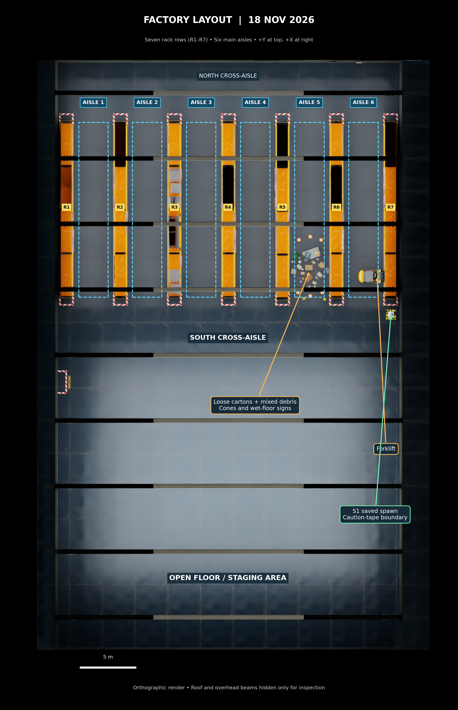
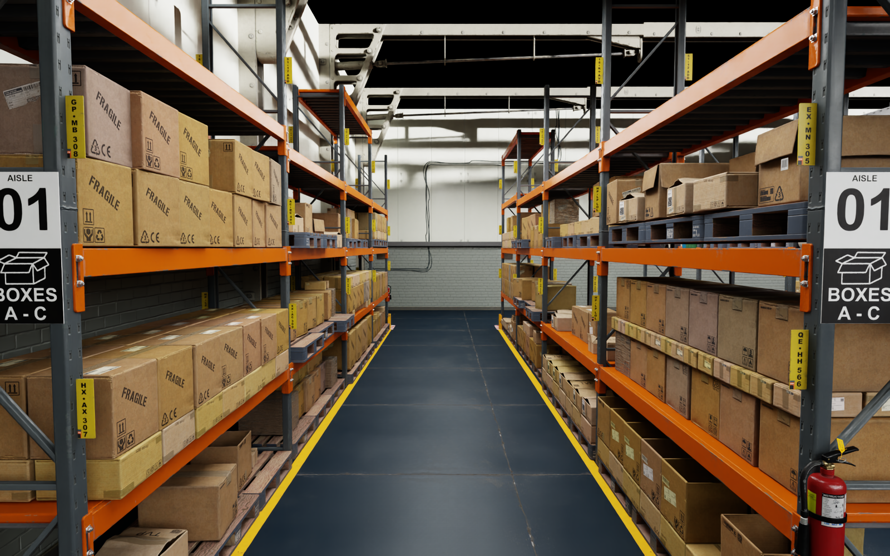
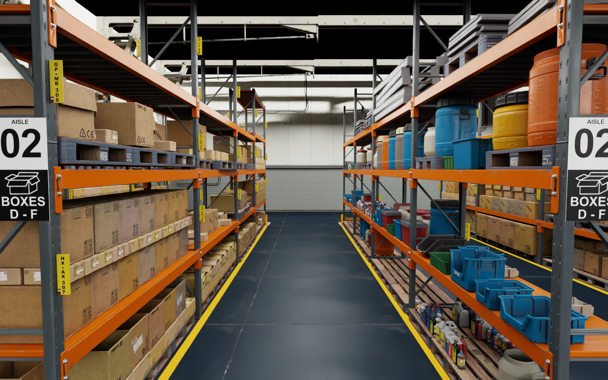
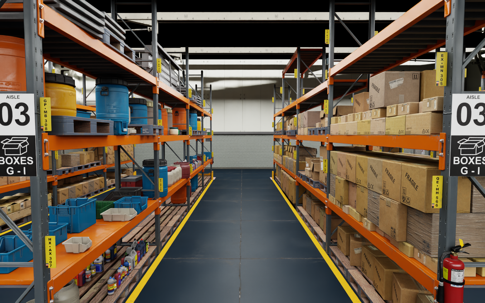
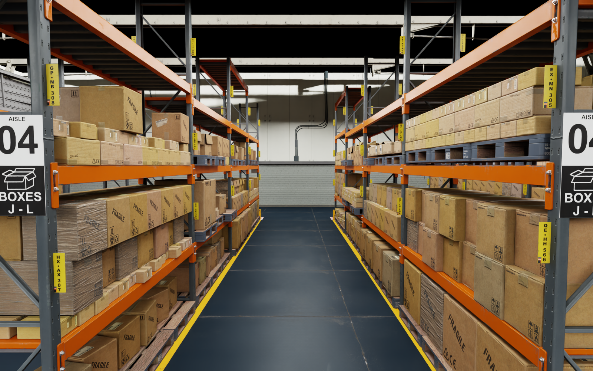
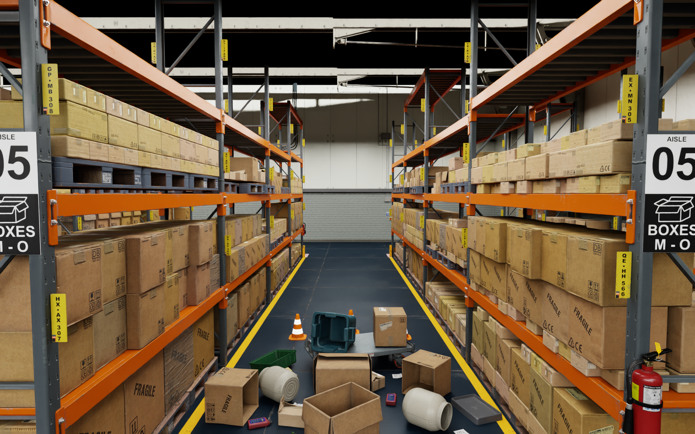
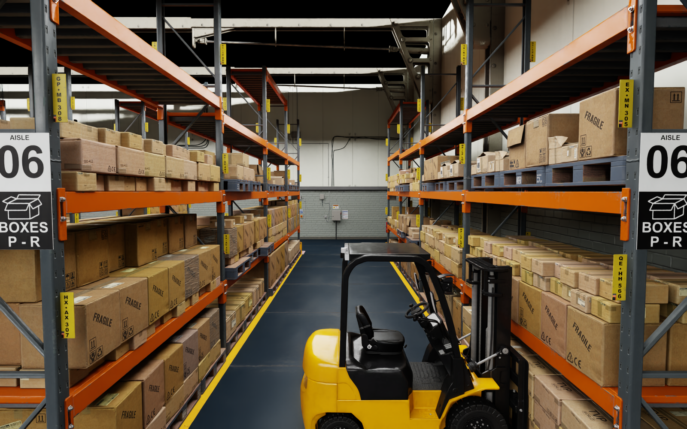

# Factory layout and box diagnosis

Inspected **November 18, 2026**, from the composed `src/Factory_Project/assets/data/environments/factory.usda` scene in Isaac Sim. This is a read-only layout and USD-physics inspection, not a grasp or navigation test. Scene assets, robot configuration and task logic were not changed.

## Layout overview

Seven parallel rack rows form **six main aisles**, numbered west to east to match the visible aisle signs. For this map, north means world **+Y**, east means **+X**; these are coordinate directions, not geographic headings. The racks run approximately from Y=8.8 to 24.9 m. Cross-aisles connect their north and south ends, with a large open floor area farther south.

The S1 spawn is beside the east wall at **(4.45, 7.30, 0.09523) m**, just south of the last rack. Aisle 5 contains floor clutter; aisle 6 contains a forklift. The dashed map outlines identify aisles, not measured collision-free routes.

The overview is an orthographic render with coordinate-aligned annotations and a 5 m scale bar. Roof panels and selected overhead structures were hidden temporarily in the session layer for inspection. Upper shelves still obscure lower cargo in the top view; use the aisle images below to see shelf contents. All aisle cameras look north from the south entrance. No visibility edits were saved to the scene.

## Box objects and physics

**Most cartons are individual USD objects, but they are static scenery today.** All **1,841** counted cardboard-box objects have one enabled mesh collider each, with `physics:approximation = "none"` (triangle-mesh collision); there are **no `UsdPhysics.RigidBodyAPI` bodies anywhere under `/World/Factory`**. The robot is outside that subtree and has its own dynamic articulation.

| Object group | Count | What the count means |
| --- | ---: | --- |
| `Box_*` | 1,833 | Individually referenced cartons on rack rows |
| `SM_CardBox*` | 8 | Separate carton objects in aisle 5's floor-clutter area |
| `Crate_*` | 47 | Separate plastic crate objects on rack row R3 |
| `SM_RackPile_*` | 7 | Grouped cargo assets on R3; not one independent object per visible item |
| Other floor plastic crates | 4 | Aisle 5 props, separate from the 47 rack crates |

Cardboard asset families are **A: 154, B: 390, C: 433, D: 864**. These are source model families, not semantic task categories or mass classes. Variants include different sizes and open/closed appearances. For example, `SM_CardBoxB_01_29` has an approximately **0.50 × 0.50 × 0.50 m** world-aligned bounding box. Other variants and rotations differ; measure the chosen object before setting a grasp target.

Representative scene paths:

- `/World/Factory/Box_2403`: an individual rack carton; its collider is beneath `SM_CardBoxB_01/SM_CardBoxB_01`.
- `/World/Factory/SM_CardBoxA_02_2`: an individual floor carton in aisle 5.
- `/World/Factory/Crate_14962`: a separate plastic crate on R3.
- `/World/Factory/SM_RackPile_91`: one grouped asset with two collider sections; visible cargo does not imply independently movable contents.

The environment is largely a flat collection of named USD prims with referenced prop assets. Aisles are spatial groupings rather than parent prims containing their boxes. Existing aisle signs are visual labels, not a task inventory API. An object's prim path identifies it; its transform and bounds locate it.

**Collision is not the same as movable-object physics.** These boxes can obstruct a dynamic robot, but they will not fall, slide or respond to grasp forces as dynamic boxes in the current composition. Mass, inertia and dynamic collision suitability have not been validated for manipulation. A later task should select or clone one suitable carton, configure its rigid body and collision approximation, establish mass/friction and a repeatable pose, then test grasping. Enabling dynamics for every stored carton is unnecessary for a first pick-and-place task. No such changes were made during this diagnosis.

## Rack inventory

Rows R1–R7 are survey labels shown on the map. Counts are per physical row, so a shared rack is not counted twice just because it borders two aisles.

| Row | Approx. center X (m) | Individually referenced rack cartons | Other counted cargo |
| --- | ---: | ---: | --- |
| R1 | -25.30 | 198 | — |
| R2 | -20.40 | 228 | — |
| R3 | -15.40 | 0 | 47 crates, 7 grouped loads; additional mixed-container props visible |
| R4 | -10.50 | 223 | — |
| R5 | -5.50 | 433 | — |
| R6 | -0.55 | 339 | — |
| R7 | 4.41 | 412 | — |
| **Total** | | **1,833** | Floor cartons excluded |

Cartons span several shelf levels; counted rack-carton bounds range roughly from **Z=0.21 to 3.81 m** across the warehouse. Visual accessibility does not establish arm reach or safe grasp clearance.

## Aisle 1 — west carton storage

Between **R1 and R2**, center X≈-22.83 m. Cardboard cartons occupy stacked shelf levels on both sides, with pallets, steel rack frames and protective end guards. The central floor appears clear in this view; traversability has not been tested.

## Aisle 2 — mixed cargo and crates

Between **R2 and R3**, center X≈-17.91 m. Cartons are on the left; the right rack contains colored plastic crates, drums/containers, bottles and grouped cargo. This is the clearest view of why a visible item is not always an independent carton prim.

## Aisle 3 — cartons and grouped cargo

Between **R3 and R4**, center X≈-12.95 m. The opposite face of the mixed-cargo rack is on the left, with carton storage on the right. R3's grouped assets must be distinguished from its separate crates before selecting a manipulation target.

## Aisle 4 — dense carton storage

Between **R4 and R5**, center X≈-7.99 m. Both sides contain dense carton stacks of varying sizes on multiple shelf levels. Shelf edges, adjacent boxes and rack uprights constrain a potential approach even where the aisle floor looks open.

## Aisle 5 — loose boxes and cones

Between **R5 and R6**, center X≈-3.02 m. The south section contains **eight carton objects**, four plastic crates, a pushcart, plastic barrels, bottles, a bucket and paper debris, marked by **six traffic cones and two wet-floor signs**. These are existing static obstacles. Some open cartons look convenient for perception studies, but this cluttered area is not yet a controlled pickup station.

## Aisle 6 — forklift and east shelves

Between **R6 and R7**, center X≈1.93 m. Cartons line both sides; a forklift near **(3.18, 10.8) m** obstructs the south section toward the east rack. The S1 starting square is just outside this aisle, beside the east wall. Proximity to spawn does not establish a clear route past the forklift.

## Scope suggested by this diagnosis

For the first controlled task, keep the warehouse static and define one pickup carton plus a drop zone on accessible floor space. Choose their locations after checking S1 reach and route clearance. Aisle 5 offers clutter for later perception/avoidance work; aisle 6 offers a fixed forklift obstacle. Neither requires changing all warehouse cargo into dynamic bodies.

Evidence consists of the composed USD hierarchy, world-space geometry bounds, physics API inspection and the linked renders. Counts describe this scene version; no per-box grasp, mass, friction, collision-shape accuracy or path-planning validation was performed.
