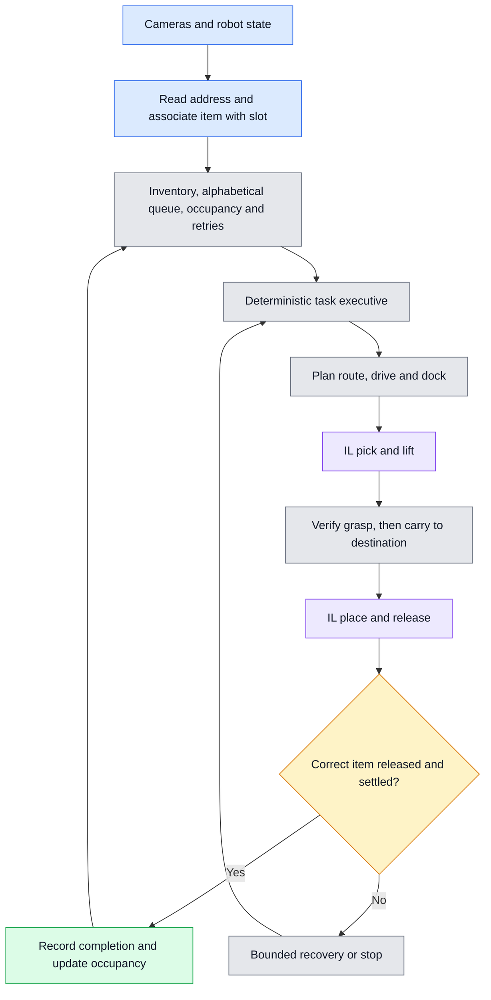
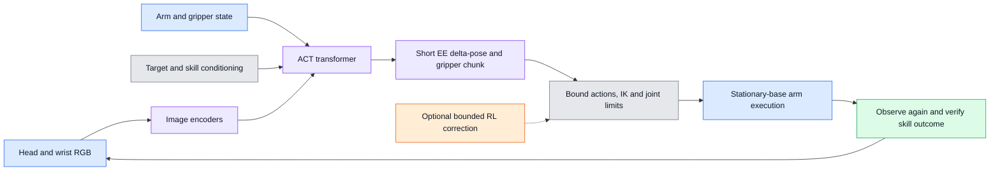
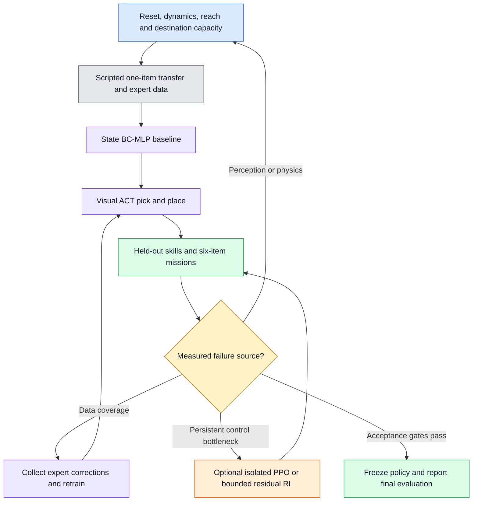

# Build reliable sorting from short skills

**Recommendation: use a deterministic task executive, classical navigation, and imitation learning for docked manipulation.** Establish a scripted controller and a small behavior-cloning MLP baseline, then train an **ACT policy for pick/lift and place/release**. Keep PPO available for a specific skill that demonstrably needs it; consider bounded residual RL only after measuring the imitation policy's failures. The long mission belongs in explicit task state, rather than requiring one network to remember and control everything.

This is a proposed architecture, not a trained or validated S1 result. Scope follows the corrected request: **one “To be sorted” rack, six items total, one from each aisle**, processed **A2 → F8 → H4 → K3 → O8 → Q4**. The older “six per aisle” wording in `vision.md` does not define this experiment. Start with one arm and a stationary base during manipulation.

## Separate the learning method from the model

| Term | Meaning here |
|---|---|
| Policy | A rule mapping observations to actions. |
| Imitation learning (IL) | Learn from expert behavior; behavior cloning (BC) predicts recorded expert actions. |
| Reinforcement learning (RL) | Improve actions through rewarded trials; delayed credit and exploration become difficult over long missions. |
| Algorithm | BC, PPO, and SAC describe training procedures. **PPO is not a neural-network architecture.** |
| Model | An MLP is a layered network; a transformer processes structured sequences. ACT combines a transformer, action chunks, and a particular training method. |
| Hierarchy | A supervisor selects short skills and checks their outcomes. It can combine learned and deterministic components. |

These distinctions follow the policy and learning concepts in [Prince's textbook](https://udlbook.github.io/udlbook/). They let us reuse your PPO experience without making PPO responsible for every part of sorting.

## Put mission memory in an explicit executive

**Diagram colors identify roles, not completion:** blue = environment/perception; gray = deterministic control/state; purple = IL; orange = optional RL; amber = decisions; green = evaluation/verification. The same palette applies throughout.

Store `object_id`, pickup slot, destination address/pose, allowed supports, carried identity, completed deliveries, stack counts, and retry budgets outside the policy. A short skill should receive its immediate target; it should not infer the whole mission from camera history.

The existing duplicated **AprilTag ID 0 is decorative**, not a unique identity system. Associate visible address text with the corresponding slot and item before pickup; rail stickers remain behind when an item moves. Track carried identity thereafter. Ambiguous readings require a changed viewpoint and bounded rereads. Under strict alphabetical order, a blocked next item triggers recovery or failure, not silent skipping.

Verify grasp through object motion relative to the gripper, retention during a short lift/hold, and available contact/gripper signals. Verify placement only after release and settling inside the correct support region. Begin with simulator truth for these checks, explicitly labeled privileged; a deployable visual system needs corresponding estimates.

Even if each complete transfer independently succeeded 95% of the time, all six would succeed only **0.95⁶ ≈ 73.5%**. This is a hypothetical illustration, not an S1 estimate; actual errors can be correlated. Verification and recovery therefore belong in the architecture from the beginning.

## Learn two bounded manipulation skills first

Use separate **pick/lift** and **place/release** policies initially, conditioned on the selected object or destination. Keep torso configuration explicit and the base still. Scripted docking must put targets within a measured manipulation workspace; learned docking becomes justified only if docking error remains a major failure source.

ACT predicts action sequences from images and robot state; its original formulation uses joint-position targets. **End-effector delta pose plus a gripper command is our proposed S1 adaptation**, requiring consistent demonstrations, action scaling, coordinate frames, and IK execution. It is not an existing ready-made controller. [ACT authors](https://tonyzhaozh.github.io/aloha/)

Proposed starting timing: at **20 Hz**, predict **10–20 steps** (0.5–1 second), execute **2–4 steps** (0.1–0.2 second), then observe again. This is receding-horizon execution. Validate actual camera, inference, and controller latency first; shorten execution near contact. These are experiment settings, not measured S1 capabilities.

| Candidate | Recommended role | Reason to defer or advance |
|---|---|---|
| Scripted planner/IK | Physical baseline and demonstration teacher | Exposes infeasible grasps and bad destinations before learning. |
| State BC-MLP | First cheap learned baseline | Tests data/action plumbing; true object poses make this a privileged baseline. |
| ACT IL | First visual manipulation candidate | Fits short demonstrated skills; no evidence yet that it wins on S1. |
| Diffusion Policy | Controlled comparison if ACT struggles with diverse valid grasps | Generates chunks by iterative denoising; benchmark quality and latency locally. |
| PPO | Isolated docking or manipulation skill with reset and useful rewards | Familiar tooling, but sparse whole-mission rewards complicate exploration. |
| SAC | Alternative isolated continuous-control experiment | Reuses experience off-policy, but adds another trainer to integrate. |
| Large VLA | Later language/unseen-task research | Long duration alone does not justify embodiment adaptation and extra complexity. |

The method descriptions come from [Diffusion Policy](https://diffusion-policy.cs.columbia.edu/), [PPO](https://arxiv.org/abs/1707.06347), [SAC](https://arxiv.org/abs/1801.01290), and [OpenVLA](https://openvla.github.io/). Their published results do not establish the best policy for this robot and warehouse.

## Make the environment executable before training

The current scene is staging, not yet a sorting benchmark. [Factory diagnosis](factory-layout.md) reports static warehouse contents; the [rack builder](../scripts/build_sorting_rack.py) does not make the selected copies dynamic. The [manager configuration](../src/Factory_Project/tasks/factory/config/AstribotS1/env_cfg.py) and [direct environment](../src/Factory_Project/tasks/factory_direct/config/AstribotS1/env.py) still contain unimplemented task setup/lifecycle behavior. A PPO configuration file does not establish task readiness.

| Prerequisite | Required evidence |
|---|---|
| Repeatable task/reset | Persistent spawn, six pickup poses, robot actions, termination, and success checks reset correctly. |
| Dynamic pickup objects | Suitable collision geometry, mass/inertia/friction; physically valid lift, carry, and release. Keep the warehouse static. |
| Feasible manipulation | Check gripper fit, payload, arm reach, approach clearance, shelf headroom, and support stability per item. |
| Real destination capacity | Reserve accessible empty placements. Original source objects remain in their source positions, so those positions are occupied. |
| Stack rules | Maximum three only for compatible objects/supports. Bins and bottles are not automatically stackable; stacking is not mandatory. |

One item per destination does not test stacking. Add separate repeated-destination cases, including rejection of a fourth item. If one selected object is physically unsuitable for this arm, resolve the grasp/tooling or task definition before blaming the policy.

## Train through measurable gates

**Pilot data proposal: 25 successful demonstrations per object per skill = 300 short trajectories** across six objects and two skills. Expand to 50 or 100 per condition only if learning curves justify it. Vary dock/item pose, lighting, camera noise, and physically plausible dynamics. The required data and compute remain unknown; benchmark simulation throughput, GPU memory, and inference latency before scaling.

With no human demonstrations, first use scripted planning/IK as the teacher and retain only verified physical successes. If expert control remains difficult after feasibility checks, train an isolated PPO skill with a staged reach→grasp→lift curriculum. Neither path requires demonstrations of the entire warehouse mission.

Collect corrections where the learner fails. DAgger specifically uses expert labels on learner-visited states; adding unrelated videos is not equivalent. [DAgger paper](https://proceedings.mlr.press/v15/ross11a.html)

Only then test a small, bounded residual controller around a frozen nominal policy for persistent contact or docking errors. Retain action limits and regression checks. Residual RL provides this controller-plus-correction pattern, but **ACT is not a drop-in replacement for the default PPO actor**. Direct fine-tuning needs a deliberately compatible training formulation. [Residual RL paper](https://arxiv.org/abs/1812.03201)

## Judge complete missions, then isolate the bottleneck

Progress through fixed-dock grasp/hold/release, unloaded navigation, loaded carry, one complete transfer, then six ordered deliveries. Define tolerances, prohibited collisions, timeouts, and retry limits before evaluation. Select checkpoints using validation rollouts, not imitation loss alone; the [Robomimic study](https://robomimic.github.io/study/) demonstrates why that distinction matters.

| Evaluation | Report |
|---|---|
| Primary outcome | All six correctly delivered in order, released and stable, within time/retry budgets, respecting collision/drop and stack rules. |
| Diagnostics | Per-skill success, first failure, wrong addresses, drops, collisions, recovery counts/success, time, distance, and interventions. |
| Fair comparisons | Same seeded scenarios: scripted baseline, scripted navigation + IL, optional learned docking, and recovery-disabled ablation. |
| Generalization | Hold out whole trajectories/scenarios; group generated variants together. Separate new poses from genuinely unseen object identities. |
| Initial test budget | Proposed 100 held-out episodes × three training seeds; report each seed and success uncertainty, accounting for correlated scenarios. |

Keep the persistent spawn for the nominal task; varied starts are separate robustness tests. Publish privileged-state and visual-policy results separately. Testing only the same six training objects supports known-object claims, not general object sorting.

**First research question:** under controlled docking and object-pose perturbations, does **IL plus bounded RL refinement** improve full six-item success over **IL alone**, after matching demonstrations, evaluation scenarios, and recovery logic? Track the extra simulation/training cost alongside success. That gives this project a falsifiable experiment while keeping the initial implementation achievable.
