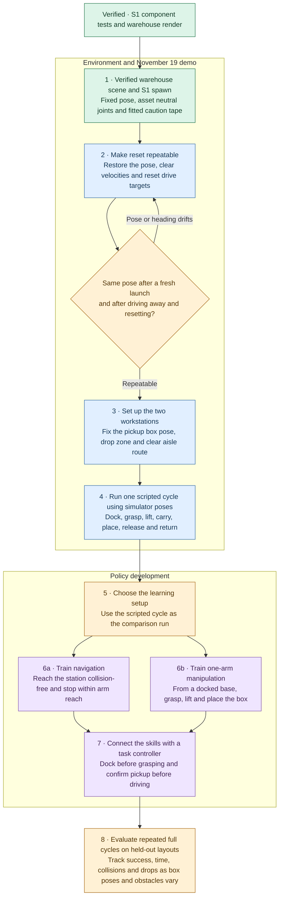
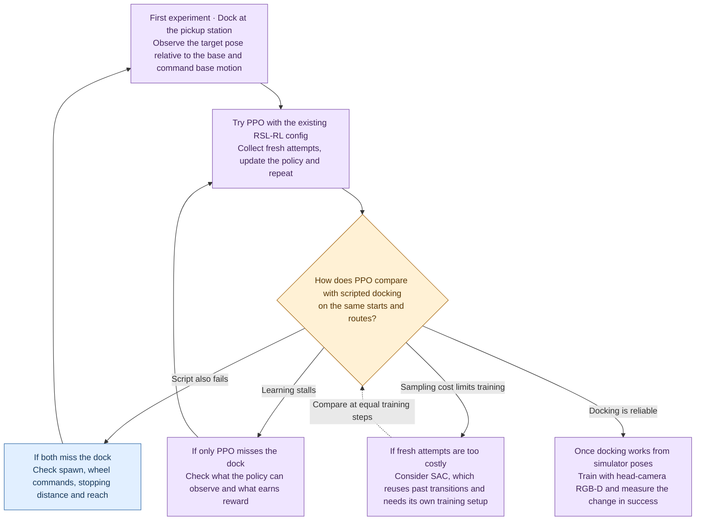

# Vision for Project

Astribot S1 doing humanoid factory task. Multi-step long-horizon task.

Visual navigation + pick and place manipulation.

## Environment

Use NVIDIA Isaac Sim's **Full Warehouse** scene (`full_warehouse.usd`) as the environment for Astribot S1 in Isaac Lab.

A full-sized industrial warehouse containing shelving, obstacles on the floor, and forklifts. The existing warehouse layout is the base scene for visual navigation and pick-and-place tasks.

Source: [Full Warehouse — NVIDIA Isaac Sim 6.2 environment catalog](https://docs.isaacsim.omniverse.nvidia.com/6.2.0/assets/usd_assets_environments.html#warehouses).

USD asset: [full_warehouse.usd](https://omniverse-content-production.s3-us-west-2.amazonaws.com/Assets/Isaac/6.2/Isaac/Environments/Simple_Warehouse/full_warehouse.usd).

## Robot

Astribot S1

Use the mobile base to move between workstations. Start with one arm for manipulation.

Validate the robot model, gripper, and camera setup before training.

The [project-owned S1 asset](src/Factory_Project/assets/data/astribot_s1/astribot_s1.usd) combines the four-wheel base and dual grippers. The [source notes](src/Factory_Project/assets/data/astribot_s1/SOURCE.md) describe the model and simulation approximations.
## Policy

Separate navigation and manipulation policies. A task controller coordinates the full sequence.

Start with scripted baselines. Train each skill before combining them into a longer task.

Measure full-task success, completion time, collisions, and dropped objects.

Source: adapt Isaac Lab's [lift_cube_sm.py](/home/eddie/IsaacLab/scripts/environments/state_machine/lift_cube_sm.py) for scripted manipulation, then train using this project's [RSL-RL PPO scaffold](/home/eddie/Desktop/Simulation/S1-Project/src/Factory_Project/tasks/factory/config/AstribotS1/agents/rsl_rl_ppo_cfg.py).

## Visual Navigation Policy

Use simulated RGB-D images to navigate toward the active workstation. Avoid obstacles and stop within manipulation reach.

Use simulator poses as an initial baseline. Evaluate visual navigation separately before adding manipulation.

Source: train a custom RGB-D navigation policy using Isaac Lab's [CameraCfg](/home/eddie/IsaacLab/source/isaaclab/isaaclab/sensors/camera/camera_cfg.py) and [RslRlCNNModelCfg](/home/eddie/IsaacLab/source/isaaclab_rl/isaaclab_rl/rsl_rl/rl_cfg.py) with RSL-RL PPO.

## Exact task

Proposed task: move a small box between two factory workstations.

Navigate to the pickup table. Locate the box, grasp it, and lift it.

Carry it to the drop-off station. Place it inside the marked area and release it.

Return to the pickup station and repeat. Gradually vary the box position and route obstacles.

For the November 19 demo, prioritize one complete sequence. Treat robust learned policies as a later milestone.

Source: author the full sequence in this project's [factory task](/home/eddie/Desktop/Simulation/S1-Project/src/Factory_Project/tasks/factory), using Isaac Lab's [locomanipulation example](/home/eddie/IsaacLab/source/isaaclab_tasks/isaaclab_tasks/contrib/locomanip_pick_place/locomanipulation_g1_env_cfg.py) as a structural reference.

## Current State

The S1 can drive forward, strafe, turn, grasp and release a box in isolated physics tests. It has also been rendered inside the Full Warehouse. **Step 1 is now persisted in `src/Factory_Project/assets/data/environments/factory.usda`:** S1 starts at `(4.45, 7.30, 0.09523)` m with a 180° heading, beside the east wall and shelf end, inside a fitted caution-tape square. Open it with `scripts/view_factory.py`. Two reloads restored the same starting pose; a two-second idle physics check measured about 15 mm of settling movement. Episode-reset integration remains step 2; the task folders are still templates. [Robot validation](README.md#validation-in-isaac-sim-62) · [Boundary screenshot](recordings/11-18-2026/12:25pm_test-boundary.png)

### Implementation phases

Green marks verified work, blue covers the environment and scripted demo, purple covers learned policies, and amber marks decisions and evaluation.

### Choosing the RL approach

There are two choices. The **environment template** determines where the code for actions, observations, rewards and resets lives. The **learning algorithm** determines how experience changes the policy. The existing `factory/` template lets us configure those pieces separately. `factory_direct/` puts them in one environment class. Both register PPO training configs. The two skills in this vision can be trained separately and called in sequence by one controller. The multi-agent template becomes relevant if we decide that multiple agents should act in the same episode. [Manager-based task](src/Factory_Project/tasks/factory/config/AstribotS1/env_cfg.py) · [Direct task](src/Factory_Project/tasks/factory_direct/config/AstribotS1/env.py) · [Multi-agent task](src/Factory_Project/tasks/factory_marl_direct/config/AstribotS1/env.py)

PPO is the proposed first experiment because it uses a familiar training loop and the repo already has a runner config. For the first comparison, count how often the S1 stops collision-free with the box inside the arm’s reach. Keep the spawn fixed while comparing policies, and vary the box and obstacle layout separately. [Existing PPO config](src/Factory_Project/tasks/factory/config/AstribotS1/agents/rsl_rl_ppo_cfg.py)
